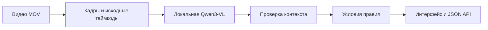

# DataSAURs — AI-помощник для проверки кассовых видео

**ForteBank AI Datathon 2026 · финальная сборка в ветке `backend`.**

DataSAURs анализирует кассовые видеозаписи на локальной NVIDIA GPU и формирует
результат для проверяющего: событие, таймкод, подтверждающие кадры и объяснение
применённого правила. Сервис доступен через веб-интерфейс и HTTP API.

## Возможности

- Загрузка `.mov`, предпросмотр и просмотр результата в браузере.
- Анализ временных окон локальной Qwen3-VL-4B-Instruct.
- Проверка видимых условий и последовательности действий модулем правил.
- Карточки найденных событий с таймкодом, объяснением и 1–3 JPEG-кадрами.
- Экспорт JSON и API с ключом для интеграции.
- Один GPU-worker, ограниченная очередь и бюджет обработки 300 секунд.

## Как работает сервис



Модель выделяет наблюдаемые действия. Контекстный проход проверяет связанные
факты, а Rule Engine сопоставляет их с условиями каталога. Неопределённость
не подменяется отрицательным результатом. Выводы описывают возможные визуальные
признаки и предоставляют материал для проверки специалистом.

## Проверенная конфигурация

| Компонент | Конфигурация |
|---|---|
| Inference | `2026.10.18.10` |
| Модель | Qwen3-VL-4B-Instruct, NF4 |
| GPU | RTX 4050 Laptop, 6 ГБ VRAM |
| Окна | 8 секунд, перекрытие 2 секунды, 4 кадра |
| Размер кадра | До 640 пикселей по длинной стороне |
| Загрузка модели | Один раз при запуске worker |
| Обработка | Локально, без облачных AI API |

Визуальный блок и `lm_head` работают в FP16. Веса:
[официальная Qwen3-VL-4B-Instruct](https://huggingface.co/Qwen/Qwen3-VL-4B-Instruct),
revision `ebb281ec70b05090aa6165b016eac8ec08e71b17`.
Дополнительный повторный опрос той же модели выключен (`VERIFY_POSITIVE_CONDITIONS=false`).

## Проверка решения

На восьми разработческих видео каждое задание завершило обработку быстрее
300 секунд; максимум — **109,453 секунды** при уже загруженной модели.
Это измерение времени, а не утверждение об успешном распознавании каждого видео.

Проверены **317 программных тестов и 436 подслучаев**, публичный API на искусственном
ролике и загрузка локальных весов при блокировке Python socket/DNS.
Программные тесты не измеряют точность модели.

Качество обнаружения и точность таймкодов остаются направлениями доработки.
Полная матрица результатов, случаи без решения и методика доступны в
[отчёте проверки](TEST_RESULTS.md) и [машиночитаемом отчёте](docs/final_report.json).
Набор использовался при разработке; независимая оценка на новых ракурсах ещё не проведена.

## Команда

| Участник | Зона ответственности |
|---|---|
| Aisana Olzhabayeva | AI/ML, локальный inference |
| Aisha Amangeldi | Правила, оценка и метрики |
| Yerassyl Yergin | Backend, API и интерфейс |

## Установка на новом компьютере

CPython 3.12, NVIDIA GPU; проверенный ноутбук — RTX 4050 Laptop 6 ГБ, драйвер 546.18.
Создать отдельное окружение, затем:

```powershell
python -m venv .venv
.\.venv\Scripts\python.exe -m pip install torch==2.5.1 torchvision==0.20.1 --index-url https://download.pytorch.org/whl/cu121
.\.venv\Scripts\python.exe -m pip install -c constraints-ai.txt -r requirements-ai.txt -r requirements-nf4.txt
.\.venv\Scripts\python.exe -B tools/download_model.py --size 4B --destination C:/local/models/Qwen3-VL-4B-Instruct
Copy-Item .env.example .env
```

В `.env` задать локальный MODEL_PATH, MODEL_QUANTIZATION=nf4, новый длинный случайный
API_KEY и пути приватного хранения. Не публиковать этот файл.

```powershell
.\.venv\Scripts\python.exe -B start_backend.py --mode real
```

Сайт http://127.0.0.1:8000/; API `/api/v1`; схема `/docs`; методика `/methodology`;
версия и готовность `/health`. Для уже подготовленного ноутбука используйте
`tools/service_manager.py status|stop|start` из AI-окружения. Менеджер читает
приватный `Documents/ForteBankPrivate/service_runtime/service.env`, а не `.env` репозитория.
После изменения исходников нужен перезапуск worker. Не запускать второй Qwen одновременно.

## API

`POST /api/v1/analyze`: X-API-Key, multipart поле `file` с MOV → `job_id`.
`GET /api/v1/jobs/{job_id}`: тот же ключ → `processing`, `done` или `failed`.
У `done`: `verdict` = `violation` / `no_violation`, `violations` с типом,
таймкодом, объяснением и 1–3 JPEG base64. `failed` не считается отрицательным ответом.
Ключ не встроен в страницу; пользовательский интерфейс использует отдельные UI-маршруты.
Максимум 64 МБ и 4 незавершённых задания; переполненная очередь возвращает 429.

## Приватность и границы применения

Нет облачного AI, анализа звука и распознавания личности. После скачивания весов
inference использует только локальные файлы. Временный HTTPS-туннель — транспорт,
не место исполнения модели. Публикацию выполняет оператор; адрес и ключ передаются жюри отдельно.

Рабочая копия видео удаляется после задания. Опциональный аудит хранится вне репозитория.
Результаты в памяти исчезают после перезапуска. Реальные видео, разметка, кадры и
описания не входят в исходники и демонстрационные материалы.

Правила описывают **возможные визуальные признаки**, не юридические выводы.
Часть признаков относится к явно обозначенному проектному чек-листу.
Неизвестные условия не превращаются в «нарушений нет».
[Каталог и ограничения](docs/POSSIBLE_SIGNS.md), [источники](docs/regulations.md).

## Проверка и воспроизводимость

```powershell
python -B -m pytest -q -p no:cacheprovider
python -B tools/local_acceptance.py
```

Первая команда требует `requirements-test.txt`; вторая использует только искусственный ролик.
Для offline smoke сначала остановить сервер и вызвать `python -B tools/offline_smoke.py`.
Реальные прогоны выполняются локально через `tools/local_acceptance.py --manifest <private.json>`;
в stdout выводятся только агрегаты. Не отправлять помощнику приватные результаты.

Материалы предыдущих AI4/AI7 версий в docs — история разработки, не финальная конфигурация.
